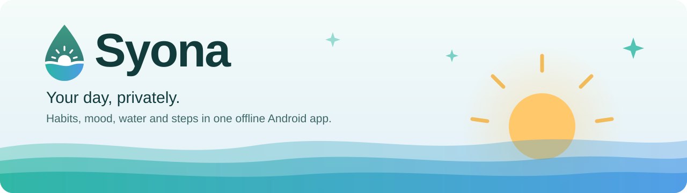
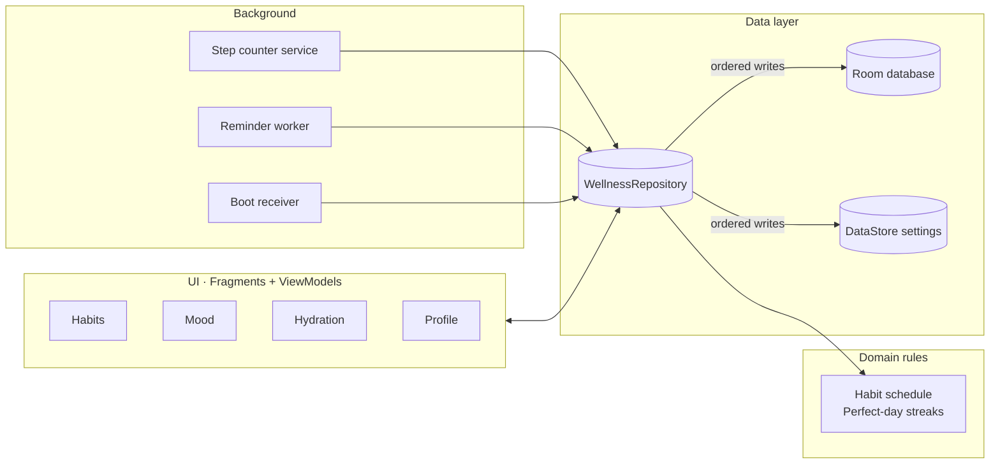

<div align="center">

<picture>
  <source media="(prefers-color-scheme: dark)" srcset="docs/assets/banner-dark.svg">
  
</picture>

<br/>

[](https://kotlinlang.org)
[-3DDC84?logo=android&logoColor=white)](https://developer.android.com)
[](https://developer.android.com/training/data-storage/room)
[](https://dagger.dev/hilt/)
[](#-quality)
[](#-privacy-by-design)

**[Features](#-features)** &nbsp;·&nbsp; **[How it works](#-how-it-works)** &nbsp;·&nbsp; **[Engineering](#-engineering-highlights)** &nbsp;·&nbsp; **[Get started](#-get-started)** &nbsp;·&nbsp; **[Roadmap](#-roadmap)**

</div>

<br/>

Most wellness apps ask you to make an account, then keep your mood notes on someone else's server. **Syona keeps everything on your phone.** Track the habits you are building, how you feel, how much water you drink and how far you walk, in one calm app that never connects to the internet.

> [!NOTE]
> Syona is a portfolio project in active development. The data layer has been rebuilt (phases 1–2 of 9). The new interface, widgets and insights are on the [roadmap](#-roadmap). Screenshots will be added after device testing.

## ✨ Features

<table>
<tr>
<td width="50%" valign="top">

### ✅ Habits
Create habits with an icon and notes, choose when they repeat (every day, weekdays, weekends, once a week, or on the days you pick) and tick them off. Everything resets at midnight, and finished days build your **Perfect days** streak.

</td>
<td width="50%" valign="top">

### 😊 Mood journal
Log one of five moods with an optional note in two taps. Browse by day as a list or a month calendar, see your most frequent mood, and follow the trend by day, week or month.

</td>
</tr>
<tr>
<td valign="top">

### 💧 Hydration
Add water in one tap, set a daily goal and get gentle reminders every 30 minutes to 8 hours. Reminders stop once you reach your goal.

</td>
<td valign="top">

### 👟 Steps
Count steps in the background with the phone's own step sensor. The counter keeps going after a restart and resets each day.

</td>
</tr>
<tr>
<td colspan="2" valign="top">

### 👤 Profile and your data
A personal profile with photo, a summary of your stats, and a mood chart. When you want a fresh start, **Clear all data** removes everything, including photos and scheduled reminders.

</td>
</tr>
</table>

## 🔒 Privacy by design

| | |
|---|---|
| **No internet** | The app does not request internet permission, and a unit test fails if it is ever added. |
| **No account** | There is no sign-up and no login. The profile lives only on your device. |
| **Your data stays put** | Habits, moods, water, steps and photos are kept in the app's private storage. |

## 🧭 How it works



`WellnessRepository` is the single source of truth. Screens read from it and write through it. It loads once at startup, serves state from memory, and saves every change to Room and DataStore through one ordered queue, so writes are never reordered or lost to a race.

## 🛠 Engineering highlights

<details open>
<summary><b>Safe migration from the original storage</b></summary>

<br/>

The first version kept all data in one JSON block in SharedPreferences. On upgrade, Syona moves it into Room **once and safely**:

- **One transaction.** Everything is written in a single database transaction, and the "done" flag is set only after it commits.
- **Safe to retry.** A crash halfway through is safe: the next launch retries with fixed IDs, so nothing is duplicated.
- **Never overwrites newer data.** Retries only add records. Anything entered since the failed attempt stays as it is.
- **Original data untouched.** The old data is only ever read, never modified.
- **Streaks carried over.** The old streak is folded into the new Perfect-days streak.

</details>

<details>
<summary><b>History you can trust</b></summary>

<br/>

Each habit tick, water entry and step count is stored against its own day, so history survives midnight instead of being wiped. Day changes, time-zone changes and reboots of the step sensor are all handled and covered by tests.

</details>

<details>
<summary><b>Runs on Android 7.0 and up</b></summary>

<br/>

The app uses `java.time` throughout. On Android 7.0 and 7.1 that API does not exist, so core-library desugaring is enabled. The release build was checked to confirm the date calls are rewritten.

</details>

<details>
<summary><b>Built with review at every step</b></summary>

<br/>

The data rebuild was planned from a written design, implemented task by task, and reviewed after each task and again as a whole. Review caught and fixed a cascade-delete bug that would have erased a habit's history on edit. Every decision is recorded in the [plan](docs/superpowers/plans/2026-11-19-data-foundation.md).

</details>

## 🧪 Quality

| Check | Status |
|---|---|
| JVM unit tests | **72 passing**: habit schedules, streak rules, migration, repository behaviour, chart data, manifest policy |
| Android lint | **0 errors** |
| Debug and release builds | ✅ |
| Instrumented tests (Room DAOs, migration writer) | Written and compiling. Not yet run on a device |

```bash
./gradlew testDebugUnitTest lintDebug
```

## 🧰 Tech stack

| Area | Choice |
|---|---|
| Language | Kotlin 2.0.21, coroutines and Flow |
| UI | Android Views with ViewBinding, Material 3, Navigation |
| Storage | Room 2.6.1 (with KSP), DataStore Preferences 1.1.1 |
| Dependency injection | Hilt 2.52 |
| Background work | WorkManager, a foreground service with the `health` type |
| Charts | MPAndroidChart |
| Build | Gradle 8.13, AGP 8.13, version catalog, core-library desugaring |
| SDK | min 24, target and compile 36 |

## 🚀 Get started

**You need:** Android Studio (recent), JDK 17 or newer, and Android SDK Platform 36. The app runs on a phone or emulator with Android 7.0 or newer.

```bash
git clone https://github.com/Ruchiyah/Syona.git
cd Syona
./gradlew installDebug        # build and install on a connected device or emulator
```

Or open the folder in Android Studio and press **Run**. Internet access is needed only at build time, to download libraries.

<details>
<summary><b>Other useful commands</b></summary>

```bash
./gradlew assembleDebug               # build app/build/outputs/apk/debug/app-debug.apk
./gradlew testDebugUnitTest           # JVM unit tests
./gradlew connectedDebugAndroidTest   # instrumented tests (needs a device or emulator)
./gradlew lintDebug                   # static analysis
./gradlew assembleRelease             # unsigned release APK
```

</details>

<details>
<summary><b>Project structure</b></summary>

```
app/src/main/java/com/example/syona/
├── SyonaApp.kt              App start: migration, then a one-time load
├── MainActivity.kt          Bottom navigation host
├── data/
│   ├── db/                  Room entities and DAOs
│   ├── settings/            DataStore-backed settings
│   ├── repository/          WellnessRepository and entity mappers
│   ├── legacy/              One-time migration from the original storage
│   ├── preferences/         Read-only parser for the original data
│   └── model/               Models shared with the UI
├── domain/                  Habit schedule and Perfect-day streak rules
├── di/                      Hilt modules
├── ui/                      habits, mood, hydration, profile, onboarding, login
├── service/                 Hydration reminders (WorkManager)
├── services/                Step counter foreground service
└── receivers/               Restarts the step counter after reboot
```

</details>

<details>
<summary><b>Permissions and why they are needed</b></summary>

| Permission | Used for |
|---|---|
| `POST_NOTIFICATIONS` | Hydration reminders and the step counter notification |
| `ACTIVITY_RECOGNITION` | Counting steps |
| `FOREGROUND_SERVICE`, `FOREGROUND_SERVICE_HEALTH` | The background step counter |
| `RECEIVE_BOOT_COMPLETED` | Restarting the step counter after a reboot |
| `VIBRATE`, `WAKE_LOCK` | Reminder vibration and WorkManager |

</details>

## 🗺 Roadmap

- [x] **Phase 1–2: Data foundation.** Room and DataStore, safe migration, per-day history, Perfect-day streaks
- [ ] **Phase 3:** Modern Compose theme, Settings, backup and restore, CSV export, a migration error screen
- [ ] **Phase 4:** Habit detail with a history calendar, a reminder time for each habit, undo
- [ ] **Phase 5:** Mood tags and editing, a water log with quiet hours, step history
- [ ] **Phase 6:** On-device insights, for example how your mood changes on days you hit your water goal
- [ ] **Phase 7:** Every screen moved to Jetpack Compose
- [ ] **Phase 8:** Home-screen widgets, an optional app lock, a new onboarding
- [ ] **Phase 9:** Accessibility and dark mode pass, CI, screenshots

## 📚 Documentation

| Document | What's inside |
|---|---|
| [Design](docs/superpowers/specs/2026-11-19-syona-portfolio-app-design.md) | Goals, architecture, data model and roadmap |
| [Data foundation plan](docs/superpowers/plans/2026-11-19-data-foundation.md) | Task plan, decisions made and follow-ups |
| [Audit and improvement plan](ANDROID_APP_AUDIT_AND_IMPROVEMENT_PLAN.md) | The original audit of the app and its fixes |
| [Technical report](ANDROID_APP_TECHNICAL_REPORT.md) | Architecture, security findings, release review |
| [Test report](ANDROID_APP_TEST_REPORT.md) | Test cases, results and a manual device checklist |

---

<div align="center">
<sub>Built by <a href="https://github.com/Ruchiyah">Ruchiyah</a> as a portfolio project. No license has been chosen yet, so all rights are reserved by default.</sub>
</div>
